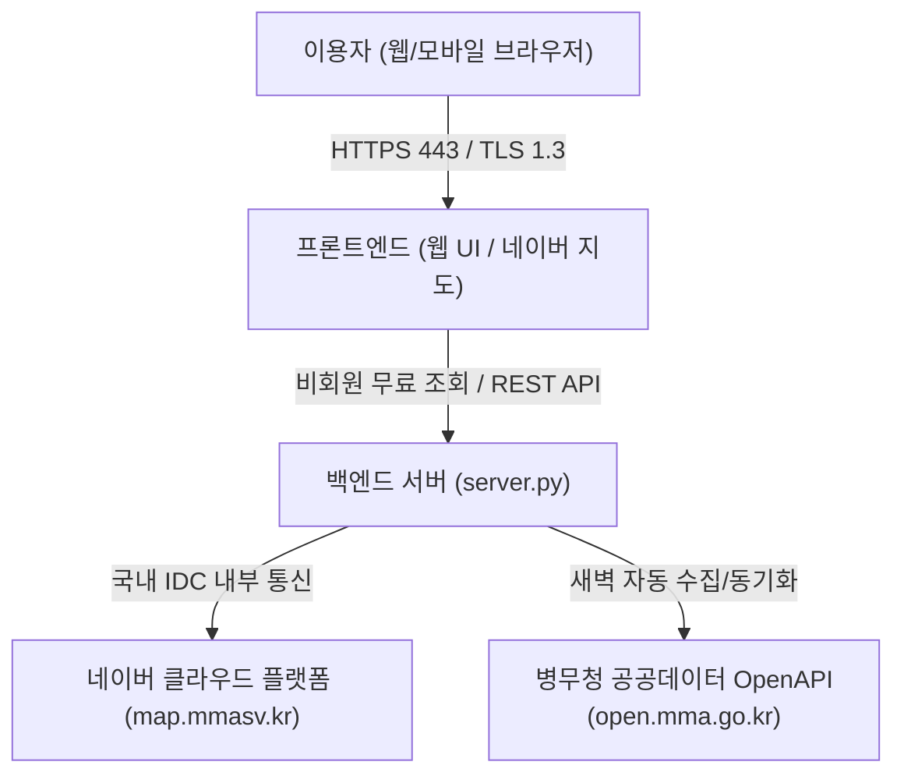

# 프로그램정의서: 나라사랑 상생가게 및 병역명문가 우대 혜택 지도 (MMAMap)

**문서 버전:** v26.28  
**최종 갱신일자:** 2026년 10월 21일  
**작성자:** Antigravity 개발팀  
**운영 환경:** 네이버 클라우드 플랫폼 (NAVER Cloud Platform 국내 IDC)

---

## 1. 개요 및 목적

### 1.1 서비스 목적
- 현역 군 장병, 입영예정자, 사회복무요원, 동원훈련 이수자 및 병역명문가 가문 구성원이 전국 각지의 제휴 할인·우대 혜택 업소를 한눈에 쉽게 찾고 활용할 수 있도록 지도 기반 위치 안내 서비스를 제공합니다.
- 복잡한 로그인이나 불필요한 개인정보 입력 없이 전 국민 누구나 100% 무료로 자유롭게 탐색할 수 있는 공공 편의 지도 서비스를 지향합니다.

### 1.2 서비스 오픈 및 운영 환경 이전
- **서비스 오픈 예정일:** 2026년 10월 22일
- **호스팅 인프라 국내 이전:** 해외 호스팅(Vercel, Render, Supabase 등)에서 국내 공공·보안 인증을 충족하는 **네이버 클라우드 플랫폼(NAVER Cloud Platform, 서울 리전)**으로 완전 이전 완료 (`https://map.mmasv.kr`).

---

## 2. 버전 정보 및 변경 이력

| 버전 | 일자 | 주요 변경 내용 | 비고 |
| :--- | :---: | :--- | :--- |
| **v26.28** | 2026.10.21 | **[정식 오픈 대비 메뉴 명칭 및 위젯 정비]** 1. **메뉴 명칭 변경**: 상단 헤더 '상생가게 안내'를 서비스 정체성에 맞춰 **'군필지도 안내'**로 변경 2. **소통정보 메뉴 정비**: '소통 & 정보' 탭에서 '공유등록 게시판' 메뉴 숨김 처리 (서비스 소개 & 약관 단일화) 3. **체험 위젯 비활성화**: 화면 좌측 '계정 체험 시뮬레이터' 및 복원 버튼 숨김 처리 완료 4. **관리자 계정 체계 정립**: 관리자 로그인 전용 계정(`admin_demo@mmamap.org`) 분리 유지 | UI/UX 정비 |
| v26.27 | 2026.10.21 | [회원가입 폼 DOM 완전 비활성화] 1. 회원가입 탭 제거 및 등록 폼 HTML 전면 주석 처리하여 클라이언트 조작 원천 차단 2. 화면 버전 표기 v26.27 갱신 | - |
| v26.26 | 2026.10.21 | [네이버 클라우드 기반 개인정보 비수집 및 익명 통계 운영 방침 전면 개편] 1. 개인정보 비수집 원칙 명문화 및 PII 수집 0건 선언 2. 비식별 익명 통계 처리 근거 및 로컬스토리지 보관 명시 | - |
| v26.25 | 2026.10.21 | [오픈 대비 보안 강화 및 국내 서버 이전 반영] 1. 신규 회원가입 기능 전면 비활성화 (API 403 차단 및 UI 숨김) 2. 네이버 클라우드 이전 반영 및 서비스 이용약관 개정 | - |
| v26.24 | 2026.10.20 | 네이버 클라우드 서버(`/api/sync-all`, `map.mmasv.kr`) 연동 및 지도 마커 렌더링 최적화 | - |
| v26.23 | 2026.10.15 | 병무청 나라사랑가게 및 병역명문가 우대업소 2종 오픈API 동기화 엔진 안정화 | - |

---

## 3. 시스템 구성 및 아키텍처

### 3.1 기술 스택
- **프론트엔드:** HTML5, CSS3, JavaScript (Vanilla JS), 네이버 지도 Web API v3
- **백엔드:** Python 3 (비동기 HTTP API 서버)
- **인프라:** 네이버 클라우드 플랫폼 (NAVER Cloud Platform Linux 인스턴스, 서울 IDC)
- **외부 연동:** 병무청 공공데이터 포털 오픈API (나라사랑가게, 병역명문가 예우업소)

---

## 4. 핵심 기능 정의

### 4.1 비회원 중심 100% 무료 지도 탐색 (신규 강화)
- **접근성 원칙:** 회원가입이나 로그인 절차 없이 접속 즉시 전국 지도에서 우대 업소를 탐색 가능
- **가입 기능 차단:** 
  - 프론트엔드 모달에서 회원가입 탭 비활성화 및 안내 문구 노출
  - 백엔드 `POST /api/auth/register` 엔드포인트에 403 Forbidden 응답 및 차단 방어막 구축
  - 불필요한 개인정보(이메일, 이름, 연락처 등) 수집 리스크 완전 해소

### 4.2 우대 혜택 필터링 및 검색
- **업종별 필터링:** 음식점, 카페/베이커리, 숙박, 의료, 여가/레저 등 카테고리별 분류
- **대상자별 필터링:**
  - 병역명문가(명문가증 소지자 및 가족)
  - 나라사랑가게(현역, 사회복무요원, 입영예정자, 동원훈련 등)
- **지역별/반경별 검색:** 현재 위치 기반 반경 검색(1km, 3km, 5km 등) 및 행정구역 선택 탐색

### 4.3 공공데이터 자동 수집 및 동기화
- 병무청 OpenAPI(`open.mma.go.kr`) 2종과의 주기적 동기화
- 매장명, 주소, 업종, 할인 내용, 연락처 등 공공데이터에 공시된 사업자 기본 정보를 정제하여 지도에 표출

---

## 5. 데이터 보안 및 개인정보 보호 조치

| 구분 | 조치 세부 내용 |
| :--- | :--- |
| **개인식별정보(PII) 원천 배제** | • 회원가입 기능 비활성화로 불필요한 회원 개인정보(이름, 생년월일, 주민번호 등) 수집 일체 차단 • 공공데이터포털에 공개된 사업자 기본 정보(상호, 주소, 매장 유선번호)만 활용 |
| **국내 인프라 보관 (국외 이전 배제)** | • 모든 데이터 및 서비스는 네이버클라우드 주식회사(NAVER Cloud Platform)의 대한민국 국내 데이터센터에만 보관 • 해외 서버로의 개인정보 또는 이용 데이터 전송 일체 없음 |
| **전송 구간 암호화** | • 전 구간 HTTPS / TLS 1.3 보안 프로토콜 강제 적용 • 비인가 데이터 도청 및 위변조 방지 |
| **접속 통계 비식별화** | • 통계 및 이용 현황 분석 시 IP 등 식별자를 마스킹 처리하여 이용자 추적 방지 |

---

## 6. 향후 운영 계획
- 정식 오픈(2026.10.22) 이후 사용자 피드백 모니터링
- 병무청 신규 제휴 가맹점 실시간 업데이트 안정성 점검
- 지자체별 병역이행자 추가 우대 혜택(공공시설 할인 등) 확장 연계 검토
